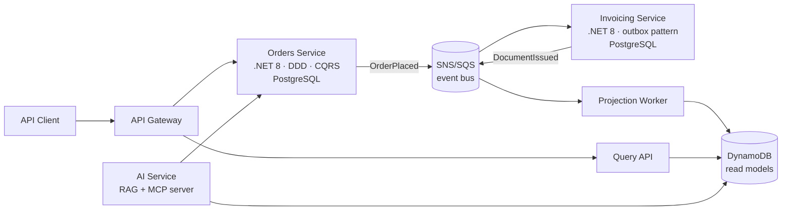

# FiscalFlow

**Cloud-native reference architecture for fiscal document processing** — built as a serious R&D project by an engineer with 16 years of production experience in Brazilian fiscal compliance (NF-e/NFC-e/NFS-e at 500+ retail locations), now reimplemented with modern cloud-native patterns.

> Status: 🚧 active development (started July 2026). See [ROADMAP.md](ROADMAP.md).

## Why this project

Real fiscal document processing has hard constraints: a store cannot sell if invoicing is down, government web services fail unpredictably, and every document must be durable, auditable, and sequenced. This makes it an excellent domain for demonstrating event-driven, highly available architecture — with real trade-offs instead of tutorial simplifications.

## Architecture



### Bounded contexts

| Context | Responsibility | Write store | Key patterns |
|---|---|---|---|
| **Orders** | Sales orders lifecycle | PostgreSQL | Tactical DDD (aggregates, domain events), CQRS with MediatR |
| **Invoicing** | Fiscal document issuance against a simulated tax authority (latency, failures, rejections modeled on real SEFAZ behavior) | PostgreSQL | Transactional outbox, idempotent consumers, retry/circuit breaker |
| **Read models** | Denormalized projections for queries and dashboards | DynamoDB | Event-driven projections, eventual consistency |
| **AI** | RAG over fiscal legislation + MCP server exposing the platform to LLM agents | pgvector | RAG, MCP, agentic workflows |

### Platform

- **Runtime:** AWS ECS Fargate, provisioned with Terraform
- **Messaging:** SNS topics + SQS queues (LocalStack for local dev)
- **CI/CD:** GitHub Actions — build, test, and deploy on merge to `main`
- **Observability:** OpenTelemetry traces/metrics/logs → CloudWatch
- **Local dev:** `docker compose up` brings up PostgreSQL, DynamoDB Local and LocalStack. The services are not in the compose file yet: today they run with `dotnet run` (see [Run locally](#run-locally))

## Run locally

What exists in the code today: the infrastructure containers and the Orders API skeleton (the ASP.NET template, with no database access yet).

**Requirements:** Docker with Compose v2 (`docker compose version` answers `Docker Compose version v2.…`) and the .NET 10 SDK, because every project targets `net10.0` (`dotnet --list-sdks` must list a `10.0.…` line; with an older SDK the build stops with `NETSDK1045`).

**1. Infrastructure.** From the repository root:

```powershell
docker compose up -d
```

| Service | Host port | Credentials (fixed in `docker-compose.yml`, local use only) | How to check |
|---|---|---|---|
| `postgres` (PostgreSQL 16) | `5432` | user `fiscalflow`, password `dev_only`, database `orders`; data kept in the `pgdata` volume | `docker compose exec postgres pg_isready -U fiscalflow -d orders` answers `accepting connections` |
| `dynamodb` (DynamoDB Local, `-sharedDb`) | `8000` | none (DynamoDB Local accepts any access key) | `docker compose ps dynamodb` shows the container `Up` |
| `localstack` (only `sns` and `sqs`) | `4566` | none | `curl http://localhost:4566/_localstack/health` lists `"sns"` and `"sqs"` as `available` or `running` |

Nothing to fill in: the values live in `docker-compose.yml`. If a port is already taken on the host, `docker compose up` stops with `port is already allocated`; free the port or change the left side of the `ports:` mapping (for example `"5433:5432"`). `docker compose down -v` stops everything and erases the `pgdata` volume.

**2. Orders API.**

```powershell
dotnet run --project src/Orders/FiscalFlow.Orders.Api --launch-profile http
```

The `http` profile (`Properties/launchSettings.json`) listens on `http://localhost:5261` with `ASPNETCORE_ENVIRONMENT=Development`; the `https` profile adds `https://localhost:7105`. The API reads no connection string or other setting of its own yet (`appsettings.json` only has logging). Check: `curl http://localhost:5261/weatherforecast` returns a JSON array with 5 items, and `http://localhost:5261/openapi/v1.json` returns the OpenAPI document (Development only).

**3. Tests.** `dotnet test` from the root builds `FiscalFlow.slnx` and runs the tests; it ends with `Passed!` and the test count.

## Design decisions

Every significant decision is recorded as an ADR in [`docs/adr/`](docs/adr/). Start with [ADR-0001: why event-driven microservices for this domain](docs/adr/0001-event-driven-microservices.md).

## Author

**Benjamim Goulart Bessa** — Senior Software Engineer. 25 years in enterprise software; principal architect of a nationwide retail ERP/POS platform (C#/.NET, Angular, SQL Server). [LinkedIn](https://www.linkedin.com/in/benjamimgoulartbessa)

## License

MIT
