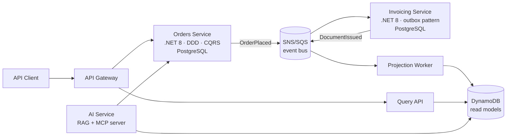

# FiscalFlow

**Cloud-native reference architecture for fiscal document processing** — built as a serious R&D project by an engineer with 16 years of production experience in Brazilian fiscal compliance (NF-e/NFC-e/NFS-e at 500+ retail locations), now reimplemented with modern cloud-native patterns.

> Status: 🚧 active development (started July 2026). See [ROADMAP.md](ROADMAP.md).

## Why this project

Real fiscal document processing has hard constraints: a store cannot sell if invoicing is down, government web services fail unpredictably, and every document must be durable, auditable, and sequenced. This makes it an excellent domain for demonstrating event-driven, highly available architecture — with real trade-offs instead of tutorial simplifications.

## Architecture

### Bounded contexts

| Context | Responsibility | Write store | Key patterns |
|---|---|---|---|
| **Orders** | Sales orders lifecycle | PostgreSQL | Tactical DDD (aggregates, domain events), CQRS with MediatR |
| **Invoicing** | Fiscal document issuance against a simulated tax authority (latency, failures, rejections modeled on real SEFAZ behavior) | PostgreSQL | Transactional outbox, idempotent consumers, retry/circuit breaker |
| **Read models** | Denormalized projections for queries and dashboards | DynamoDB | Event-driven projections, eventual consistency |
| **AI** | RAG over fiscal legislation + MCP server exposing the platform to LLM agents | pgvector | RAG, MCP, agentic workflows |

### Platform

- **Runtime:** AWS ECS Fargate, provisioned with Terraform
- **Messaging:** SNS topics + SQS queues (LocalStack for local dev)
- **CI/CD:** GitHub Actions — build, test, and deploy on merge to `main`
- **Observability:** OpenTelemetry traces/metrics/logs → CloudWatch
- **Local dev:** `docker compose up` brings up PostgreSQL, DynamoDB Local, LocalStack, and all services

## Design decisions

Every significant decision is recorded as an ADR in [`docs/adr/`](docs/adr/). Start with [ADR-0001: why event-driven microservices for this domain](docs/adr/0001-event-driven-microservices.md).

## Author

**Benjamim Goulart Bessa** — Senior Software Engineer. 25 years in enterprise software; principal architect of a nationwide retail ERP/POS platform (C#/.NET, Angular, SQL Server). [LinkedIn](https://www.linkedin.com/in/benjamimgoulartbessa)

## License

MIT
